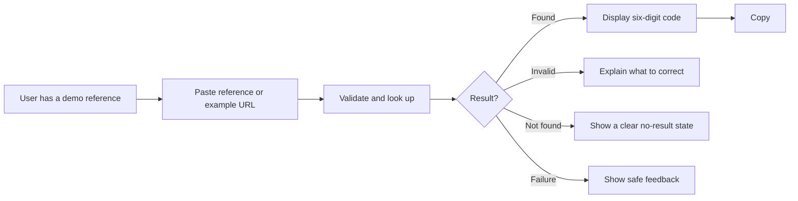
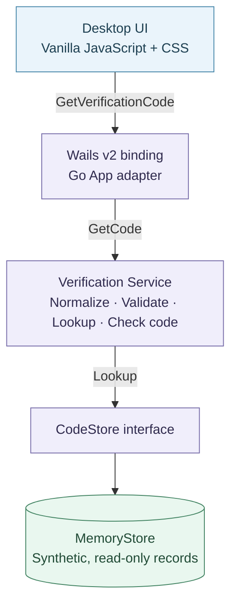

<div align="center">
  <h1>Verification Desk</h1>
  <p><strong>A simpler interface for a technical lookup workflow.</strong></p>
  <p>A lightweight desktop application that turns reference-based code lookup into a clear, accessible experience—without requiring users to understand data stores, terminal commands, or backend internals.</p>
  <p>
    <a href="https://go.dev/"></a>
    <a href="https://v2.wails.io/"></a>
    <a href="https://developer.mozilla.org/en-US/docs/Web/JavaScript"></a>
    <a href="https://developer.mozilla.org/en-US/docs/Web/CSS"></a>
    
    
  </p>
  <p>
    <a href="#the-problem">The problem</a> ·
    <a href="#demo-walkthrough">Demo walkthrough</a> ·
    <a href="#architecture">Architecture</a> ·
    <a href="#run-locally">Run locally</a> ·
    <a href="#engineering-decisions">Engineering decisions</a>
  </p>
</div>

---

## The problem

Some seemingly simple tasks depend on infrastructure that non-technical users should never have to operate directly.

Consider a testing workflow in which someone needs to retrieve a **sample verification code** associated with a reference. A manual approach might require knowledge of internal record formats, data-store keys, command-line tools, or help from an engineer.

The challenge is not just retrieving a value. It is **turning a technical operation into an understandable, predictable workflow** for the person who needs the result.

| Infrastructure-oriented experience | User-oriented experience |
| --- | --- |
| Understand how records are stored | Paste a reference or example URL |
| Navigate technical tools or ask an engineer | Click **Get code** |
| Interpret low-level results and errors | Receive a clear result or actionable message |
| Copy the right field from raw data | Copy a six-digit sample code |

**Verification Desk explores that abstraction through a self-contained desktop demo.** It focuses on the interaction and the software boundaries—not on connecting to a production system.

## What it does

- Accepts a fictional reference such as `DEMO-1001`, or an example URL containing it.
- Normalizes and validates input before lookup.
- Retrieves a deterministic six-digit code from an **in-memory store**.
- Preserves leading zeros (for example, `001234`).
- Displays clear states for success, invalid input, no result, and unexpected failures.
- Provides loading feedback, a retry action when appropriate, and a one-click copy button.
- Ignores outdated lookup responses when the input changes during a request.

> [!IMPORTANT]
> **Demo only.** All references and codes are synthetic. They cannot authenticate users or complete real-world operations. This application does not access real authentication systems or external infrastructure.

## Demo walkthrough

```text
1. Open Verification Desk
2. Paste a fictional reference: DEMO-1001
3. Select “Get code”
4. View the result: 001234
5. Copy the complete code
```

| Input | Expected behavior |
| --- | --- |
| `DEMO-1001` | Returns `001234` |
| `DEMO-1002` | Returns `450067` |
| `DEMO-1003` | Returns `928105` |
| `DEMO-9999` | Shows a no-result state |
| `https://demo.example/verify/DEMO-1001` | Extracts `DEMO-1001` and returns `001234` |
| `not-a-reference` | Shows an input-validation message |

The example URL is **parsed locally; it is never opened or requested**.

### From an internal operation to a friendly interaction



*Visual demonstration note:* a real application screenshot or short GIF can be added after the desktop build has been validated. This README does not present a mockup as a tested application screenshot.

## Architecture

The design deliberately separates the desktop framework, application logic, and data access. The goal is **testability and clear responsibilities**, not a large architectural framework.



| Layer | Responsibility |
| --- | --- |
| **UI** | Input, loading, result rendering, retry, clipboard feedback, stale-response protection |
| **Wails App** | Exposes a small method to the desktop UI and maps domain outcomes to safe response states |
| **Verification Service** | Normalizes the fictional reference, validates the returned six-digit code, and handles expected errors |
| **CodeStore** | Minimal data-access contract, independent of Wails and storage technology |
| **MemoryStore** | Read-only map with deterministic examples; no network or credentials |

A central backend contract is intentionally small:

```go
type CodeStore interface {
    Lookup(ctx context.Context, reference string) (
        code string,
        found bool,
        err error,
    )
}
```

### Does it use Redis?

**No. The current implementation does not connect to Redis.** It uses `MemoryStore`, which returns predefined fictional values from a Go map. No Redis server, credentials, network connection, database, or environment configuration is required.

The application demonstrates **how a UI can hide the complexity of a data-lookup operation** and how a service can depend on a storage contract rather than a concrete implementation. It **does not yet demonstrate working Redis connectivity**.

A future, explicitly opt-in `LocalRedisStore` could implement the same `CodeStore` interface using a local demonstration instance and a new, fictional key scheme. Such an adapter is **not included** in the current project, and remote or corporate infrastructure is outside its scope.

## Engineering decisions

| Decision | Why it matters |
| --- | --- |
| **Go for the application logic** | Small, typed service code with straightforward unit testing |
| **Wails v2 instead of a browser-only app** | Presents the workflow as a focused desktop utility while keeping Go bindings local |
| **Vanilla JS + CSS** | Avoids a UI framework for a single-purpose interaction |
| **`CodeStore` as a minimal interface** | Separates lookup policy from the in-memory implementation without creating unnecessary layers |
| **Six-digit codes as strings** | Prevents loss of leading zeros |
| **`context.Context` checks** | Allows cancellation to propagate through the backend lookup path |
| **Request identity in the frontend** | Prevents a late result from replacing the UI state for a newer input |
| **Structured response states** | Keeps backend failure details out of user-facing messages |
| **Synthetic fixtures** | Makes the demo reproducible and safe to run offline |

### Result states

| Status | UI meaning | Retry behavior |
| --- | --- | --- |
| `success` | A valid demo code was found | Not needed |
| `invalid_input` | The reference is missing or malformed | Edit the input |
| `not_found` | The reference has no sample record | Check another reference |
| `unavailable` | The store reports an availability failure | Retryable |
| `error` | An unexpected or invalid outcome occurred | Controlled generic feedback |

In normal memory-only operation, `unavailable` is a defensive outcome supported by the application contract, **not evidence of an actual remote service outage**.

## Project structure

```text
verification-desk-demo/
├── app.go                         # Wails adapter and response mapping
├── main.go                        # Desktop application bootstrap
├── internal/
│   ├── verification/
│   │   ├── service.go             # Validation and lookup rules
│   │   └── service_test.go
│   └── store/
│       ├── memory.go              # Read-only synthetic records
│       └── memory_test.go
├── frontend/
│   ├── src/
│   │   ├── main.js
│   │   ├── style.css
│   │   ├── features/verification/  # Form, results, presentation logic
│   │   └── shared/ui/             # Feedback elements
│   └── package.json
├── build/                         # Local app icon/configuration assets
├── go.mod
├── wails.json
└── README.md
```

## Run locally

### Requirements

- **Go 1.26+**, as declared by this demo's `go.mod`.
- **Node.js and npm** compatible with the project's Vite 7 tooling (Node.js 22 LTS is a suitable choice).
- **Wails v2 CLI** and the native desktop dependencies for your operating system.

See the [Wails v2 installation guide](https://v2.wails.io/docs/gettingstarted/installation/) for platform-specific prerequisites. On macOS, install Xcode Command Line Tools when required.

### 1. Prepare the environment

```bash
# From the verification-desk-demo directory
npm ci --prefix frontend
go mod tidy

# Install the Wails v2 CLI if it isn't available yet
go install github.com/wailsapp/wails/v2/cmd/wails@v2.16.0
wails doctor
```

### 2. Start the desktop application

```bash
wails dev
```

Use `DEMO-1001` as the first test input. No Redis service is needed.

### 3. Build locally

```bash
wails build
```

Native builds have not yet been verified on all target operating systems. Do not assume cross-platform distribution has been certified merely because Wails supports those targets.

## Tests

The repository includes unit tests for reference normalization, lookup results, error paths, cancellation, memory-store behavior, concurrent reads, and frontend result presentation.

```bash
# Build the embedded frontend assets first
npm ci --prefix frontend
npm run build --prefix frontend

# Backend checks
go test ./...
go test -race ./...
go vet ./...

# Frontend unit tests
npm test --prefix frontend
```

These commands are provided for local verification. The existence of tests is **not** a claim that every operating-system build or end-to-end desktop interaction has already been certified.

## Security and scope

This project is a **deliberately isolated technical demonstration**:

- No real verification or one-time passwords.
- No external API or authentication provider integration.
- No Redis connection, connection strings, or embedded credentials.
- No business-specific database keys, request formats, or operational dependencies.
- No access to real user accounts or production systems.

**Source and asset provenance:** before any public release, verify that every included UI file and asset is owned by the publisher or appropriately licensed for redistribution. A standalone demo and synthetic backend do not, by themselves, establish permission to publish reused interface code.

## Current limitations and possible next steps

| Current limit | Possible follow-up |
| --- | --- |
| Static demo records | Add more synthetic scenarios only where they improve testing |
| Memory-only storage | Optional local-only Redis adapter, never required for basic use |
| No validated desktop screenshot | Capture a screenshot/GIF from a successfully tested native build |
| No public release workflow | Add minimal automated checks after build and provenance review |
| No real authentication or persistence | Intentionally out of scope |

The guiding principle is simple: **a small, useful application should demonstrate good engineering judgment without becoming an unnecessary platform.**

---

<div align="center">
  <p><strong>Built to demonstrate Go backend design, testable boundaries, and user-focused developer tooling.</strong></p>
  <sub>Offline demo · Synthetic data · No real verification capability</sub>
</div>
